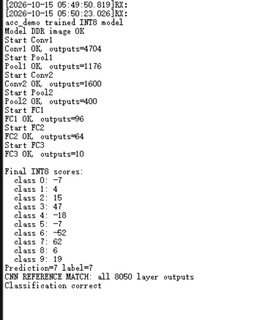
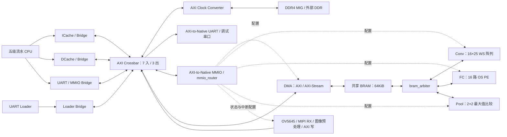

# soc_learning：五级流水 RISC-V SoC 与 INT8 CNN 加速器

本工程使用 SystemVerilog 实现五级流水 CPU，并通过 AXI、DDR4、DMA 和共享 BRAM 连接 Conv、FC、Pool 三种计算单元。CPU 执行裸机 C 程序，负责配置与逐层调度；卷积、全连接和最大池化由硬件执行。

当前网络为 `1×32×32 → Conv1 → Pool1 → Conv2 → Pool2 → FC1 → FC2 → FC3`，全连接维度为 `400→96→64→10`。工程已经完成一次真实训练权重的单张图片上板验证，七个计算阶段共 **8050 个 INT8 输出**与软件整数参考一致。现已接入 OV5645 双通道 MIPI CSI-2 摄像头，由硬件生成 32×32 INT8 输入，支持实时手写数字识别和串口图像预览。

| 项目        | 当前实现                                                                                     |
| ----------- | -------------------------------------------------------------------------------------------- |
| 硬件顶层    | [rtl/soc_top.sv](rtl/soc_top.sv)                                                                |
| CPU         | 32 位、顺序执行、IF/ID/EX/MEM/WB 五级流水，RV32I 整数指令通路、机器模式 CSR、自定义 CMP/CMPU |
| Cache       | 独立 ICache/DCache，各 2 路、32 组、每行 1 个 32 位字                                        |
| 互连        | 32 位 AXI4，7 个主机入口、3 个目标出口                                                       |
| 存储        | 外部 DDR4；共享 BRAM 为 16384×32 bit，即 64KiB                                              |
| Conv        | 5×5、stride=1、无 padding，16×25 WS PE 阵列，INT32 部分和                                  |
| FC          | 16 路 OS PE，按 16 个输出分组，支持尾组不足 16 个输出                                        |
| Pool        | 固定 2×2、stride=2，有符号 INT8 最大池化，无整行缓存                                        |
| 输出处理    | INT32 累加及偏置、整数 MULT/SHIFT 量化、舍入、可选 ReLU、INT8 限幅                           |
| Camera      | OV5645、双数据 lane MIPI CSI-2、128×128 RGB565；4×4 平均池化和阈值二值化后输出 32×32 INT8 |
| 已验证 FPGA | `xczu5ev-sfvc784-2-e`，CPU/加速器时钟 100MHz，Vivado 2022.2                                |

## 1. 上板结果

### 固定图片逐层自检

下面是实际串口截图，使用训练导出的图片、权重、INT32 偏置和各层量化参数：



截图记录的七层输出数依次是 `4704、1176、1600、400、96、64、10`，最终 `Prediction=7`、`label=7`，并打印 `CNN REFERENCE MATCH: all 8050 layer outputs`。

这是一张图片、一次配套模型包的验证记录。更换训练权重、图片或量化参数后，以当次构建生成的参考结果为准；该截图不代表完整 MNIST 测试集精度、推理吞吐率或任意形状支持情况。

### OV5645 摄像头实时识别

摄像头拍摄白纸上的手写数字 `5`，串口截图中第 4913～4939 个推理帧连续输出 `prediction=5`。以下为该截图中的实际结果节选：

```text
CAMERA_INPUT_BEGIN frame=4921 size=32x32 chars_per_pixel=2
INT8 expected=0..127 min=0 max=127 out_of_range=0
Levels low->high: [ .:-+*#@]; ? = outside 0..127
```

上述信息之后是 32×32 ASCII 图像；此处省略图像行，保留同次截图中的推理输出：

```text
CAMERA_INPUT_END
Frame 4921 prediction=5 scores: 0 -2 -21 7 -28 20 2 2 9 -6
Frame 4922 prediction=5 scores: -9 13 1 7 -45 15 5 8 11 -28
Frame 4923 prediction=5 scores: -16 14 2 13 -52 21 2 9 5 -35
```

`scores` 从左到右对应数字 `0～9` 的十个有符号 INT8 分数；`prediction` 是最大分数对应的类别，不是概率。第 4921 帧的类别 `5` 得分为 `20`，高于其余类别。

**拍摄时使用白纸黑字，手写数字的笔画要粗，建议用粗黑色记号笔，避免细笔画。** 数字应完整、居中，四周留白，避免手指、纸边或明显阴影进入画面。截图仍有额外前景和部分断笔，这次结果记录的是该场景下识别出 `5`，不作为完整测试集准确率。

## 2. 硬件总体架构



实线表示数据或总线通路，虚线表示寄存器配置关系。CPU 的 UART 打印与通用 MMIO 在 Crossbar 上是两个独立入口，图中合并显示。

Crossbar 的 7 个入口依次为 ICache、DCache、Loader、CPU UART、CPU MMIO、DMA、Camera；3 个出口依次为 DDR、UART、MMIO。Camera 作为独立 AXI 写主机接到 `s_axi[6]`。文件名 `taxi_axi_crossbar_3s.sv` 沿用原名称，实际由 `soc_top` 参数化为 `S_COUNT=7`、`M_COUNT=3`。入口 AXI ID 为 5 位，追加 3 位来源编号后，出口 ID 为 8 位。

CPU、Bridge、DMA 和计算模块使用前端 `clk`。DDR 后端使用 MIG 的 `c0_ddr4_ui_clk`，由 `axi_clock_converter_0` 处理两个时钟域之间的 AXI 通路。CPU 的复位释放同时受板级复位、Loader 启动状态和 DDR 校准完成状态控制，Loader 与总线前端能在 CPU 尚未启动时工作。

一次 Conv/FC 任务的顺序为：CPU 配置 DMA 装载输入、权重和偏置 → 配置并启动计算单元 → 结果写回共享 BRAM → DMA 搬回 DDR → CPU 校验并调度下一层。Pool 直接消费 BRAM 中前一层 Conv 的输出。当前裸机程序按层串行启动计算核。

## 3. 工程目录

```text
soc_learning/
├── rtl/
│   ├── soc_top.sv                 SoC 顶层与外部 DDR/UART/Camera 接口
│   ├── define.sv                  指令、总线、地址和容量宏
│   ├── core_cpu/
│   │   ├── if/                    取指、PC、ICache
│   │   ├── id/                    译码、寄存器堆、数据冒险检查
│   │   ├── ex_stage/              ALU、前递、分支重定向、CSR
│   │   ├── mem_stage/             访存、DCache、UART/MMIO 分流
│   │   ├── wb_stage/              写回数据选择
│   │   └── Ctrl.sv、流水级寄存器等
│   ├── axi/
│   │   ├── bridge/                CPU/Cache/Loader 到 AXI 的转换
│   │   ├── axi_crossbar/rd/        AXI 读地址和读数据通路
│   │   ├── axi_crossbar/wr/        AXI 写地址、写数据和响应通路
│   │   ├── dma/3interface/        AXI、AXI-Stream、描述符接口定义
│   │   ├── dma/                   DMA 控制及共享 BRAM 接入
│   │   └── mmio_router.sv         DMA/Conv/Pool/FC/Camera 寄存器路由
│   ├── camera/
│   │   ├── config/                OV5645 ROM、上电复位控制和 SCCB/I2C
│   │   ├── ip/                    MIPI CSI-2 RX IP 与生成/时钟说明
│   │   └── video_process/         灰度、采集、4×4 平均池化、打包和 AXI 写
│   ├── loader/uart/               串口物理收发
│   ├── loader/                    下载协议与复位/CDC 控制
│   └── coprocessor/
│       ├── conv/                  卷积控制、窗口生成和部分和存储
│       ├── fc/                    全连接分组、特征重放和结果处理
│       ├── pool/                  最大池化索引、比较和写回
│       ├── pe_ws.sv、pe_os.sv      两类 PE
│       └── bram_arbiter.sv、bram_for_acc.sv
├── cnn_test/                      裸机推理、整数参考、模型打包与交叉构建
├── net/                           PyTorch 网络训练和量化导出
├── parameter_example/             示例模型参数、量化配置和逐层参考 CSV
├── download/                      主机端 UART 下载工具
├── architecture diagram/          draw.io 源图与阵列映射 SVG
├── LICENSES/                      第三方 MIT 许可文本
├── download.png                   上板串口结果截图
├── build_5pipeline_p5b.tcl         迁移前布局的 Vivado 构建脚本
├── THIRD_PARTY_NOTICES.md          第三方组件来源与许可说明
├── LICENSE                        工程许可说明及 CERN-OHL-S-2.0 标准正文
└── README.md
```

`.git/`、`.vscode/` 和工作区配置属于版本管理、编辑器辅助内容。`cnn_test/build/`、`__pycache__/` 等目录在运行工具后生成。

## 4. CPU：`rtl/core_cpu/`

CPU 采用顺序五级流水，流水级之间使用寄存器保存指令信息、运算数和控制信号。访存、数据依赖和分支跳转通过暂停、前递与冲刷协同处理。

| 目录 / 文件                                              | 硬件职责                                                       |
| -------------------------------------------------------- | -------------------------------------------------------------- |
| `if/pc_reg.sv`、`mux_pc.sv`                          | PC 保存及下一 PC 选择，响应重定向、暂停和复位                  |
| `if/if_stage.sv`、`icache.sv`、`inst_ram.sv`       | 取指阶段封装、指令缓存及取指存储接口                           |
| `id/id.sv`、`id_stage.sv`                            | 指令译码，生成寄存器地址、立即数、ALU/访存/CSR 控制            |
| `id/reg_file.sv`、`id_req.sv`                        | 32 个通用寄存器及译码阶段依赖检查                              |
| `ex_stage/ex.sv`、`ex_stage.sv`、`ex_req.sv`       | 整数运算、运算数前递、跳转重定向及执行阶段控制                 |
| `ex_stage/csr_file.sv`                                 | `mstatus/mie/mtvec/mepc/mcause/mip`、机器外部中断和 `mret` |
| `mem_stage/mem.sv`、`mem_stage.sv`                   | load/store 对齐与字节选择、请求/响应等待、DDR/UART/MMIO 分流   |
| `mem_stage/dcache.sv`                                  | 数据缓存、写穿通路和 DMA 写后失效                              |
| `wb_stage/wb_stage.sv`                                 | 将 ALU、访存或 PC+4 等结果送回寄存器堆                         |
| `if_id.sv`、`id_ex.sv`、`ex_mem.sv`、`mem_wb.sv` | 相邻流水级之间的数据、控制和 valid 状态保存                    |
| `Ctrl.sv`                                              | 汇总 Loader、访存、冒险、分支和中断请求，产生暂停与冲刷        |
| `dbg_uart_tx.sv`                                       | 独立的串口发送逻辑；当前 CPU 打印还经过 AXI UART 通路          |

ICache 和 DCache 都是两路组相联、32 组、每行一个 32 位字，每个 Cache 的有效数据容量为 **256 字节**，不含 tag、valid 和替换状态。DCache 的 store 采用写穿方式，不依靠脏行回写把模型结果同步到 DDR。

顶层把 `dma_irq | conv_irq | fc_irq | pool_irq | camera_irq` 汇总到机器外部中断输入，没有独立 PLIC。CPU 以 `mstatus.MIE`、`mie.MEIE` 控制是否响应。当前 CNN 程序默认使用机器外部中断保存完成事件，`build_cnn.py --polling` 可恢复原 MMIO 轮询；上面的固定图片自检截图来自原轮询版本，摄像头模式使用当前默认的中断完成处理。等待完成时可执行非阻塞的 `cnn_background_work()`；默认钩子为空闲循环，未实现 WFI 休眠。详见 [中断模式说明](cnn_test/INTERRUPTS.md)。DMA 写 DDR 后仍会通过独立完成脉冲触发 DCache 失效，这条一致性通路不受软件中断使能影响。

编译目标使用 RV32I，不使用 M/C 扩展。自定义 CMP/CMPU 的指令定义见 `rtl/define.sv`；需要使用扩展时应由匹配的编译器或汇编生成。当前 FENCE/FENCE.I 译码仅传递标志，尚无独立的 Cache 刷新或总线排空单元，不能把它描述为完整的标准屏障实现。

## 5. AXI、DMA 与共享 BRAM

### `rtl/axi/bridge/` 与 `rtl/axi/axi_crossbar/`

| 文件 / 子目录                                         | 职责                                                                 |
| ----------------------------------------------------- | -------------------------------------------------------------------- |
| `bridge/icache_bridge.sv`                           | 将取指 miss 请求转换为 AXI 读事务                                    |
| `bridge/dcache_bridge.sv`                           | 数据访存到 AXI 的转换，并处理 CPU 数据地址映射                       |
| `bridge/loader_bridge.sv`                           | 将 Loader 下载写请求转换为 AXI 写事务                                |
| `bridge/mmio_bridge.sv`                             | CPU 通用寄存器请求到 AXI 的转换                                      |
| `bridge/uart.sv`                                    | CPU 串口打印请求到 AXI 的转换                                        |
| `bridge/bridge_top.sv`                              | 汇总前端 Bridge 与各 AXI 入口                                        |
| `bridge/axi2native_mmio.sv`、`axi2native_uart.sv` | 在目标端把 AXI 事务转换回模块的原生请求/响应                         |
| `axi_crossbar/rd/`                                  | 读地址仲裁、地址译码、读数据返回及读通道寄存器                       |
| `axi_crossbar/wr/`                                  | 写地址仲裁、写数据路由、写响应返回及写通道寄存器                     |
| `axi_crossbar/taxi_axi_crossbar_3s.sv`              | 合并读写 Crossbar，顶层实际配置为 7 入 3 出                          |
| `mmio_router.sv`                                    | 按地址把原生 MMIO 请求分派给 DMA、Conv、Pool、FC、Camera，并路由响应 |

`rd/` 和 `wr/` 保留了同名公共模块，例如 `taxi_axi_if`、`taxi_arbiter`、`taxi_penc`、`taxi_axi_crossbar_addr`。构建时公共定义只选一份，不能递归加入全部 `.sv` 后重复定义模块。`dma/3interface/axi.sv` 也定义 `taxi_axi_if`。

### `rtl/axi/dma/` 与 `rtl/axi/dma/3interface/`

| 文件                               | 职责                                                           |
| ---------------------------------- | -------------------------------------------------------------- |
| `dma_ctrl.sv`                    | 保存 DDR 地址、长度、BRAM 偏移、状态和中断掩码，产生读写描述符 |
| `taxi_axi_dma.sv`                | 封装 DMA 读、写通路                                            |
| `taxi_axi_dma_rd.sv`             | 根据描述符从 DDR 发起 AXI 读，将数据输出为 AXI-Stream          |
| `taxi_axi_dma_wr.sv`             | 接收 AXI-Stream，向 DDR 发起 AXI 写并返回描述符状态            |
| `dma_subsystem_top.sv`           | 连接控制器、DMA、AXI-Stream 和共享 BRAM，产生写完成失效通知    |
| `3interface/axi.sv`              | `taxi_axi_if`，包含 AXI 五通道及主从 modport                 |
| `3interface/axis.sv`             | `taxi_axis_if`，定义 data/valid/ready/keep/last 等流接口     |
| `3interface/taxi_dma_desc_if.sv` | 定义源/目的地址、长度、tag、状态等描述符接口                   |

本工程中 **DMA 读 = DDR→BRAM，DMA 写 = BRAM→DDR**。DDR 大块数据直接通过 DMA 搬运，CPU 不逐个转运权重。读写方向有独立描述符与完成状态；共享存储区的访问顺序仍由当前软件串行调度保证。

### `rtl/coprocessor/` 下的共享存储与 PE

| 文件                                            | 职责                                                                           |
| ----------------------------------------------- | ------------------------------------------------------------------------------ |
| [bram_for_acc.sv](rtl/coprocessor/bram_for_acc.sv) | 双端口 64KiB 共享 BRAM，A 口连接 DMA 流，B 口连接仲裁后的计算核                |
| [bram_arbiter.sv](rtl/coprocessor/bram_arbiter.sv) | 锁存 Conv/FC/Pool 使用权，选择读写通路及返回 valid，并阻止运行期间 DMA 写 BRAM |
| [pe_ws.sv](rtl/coprocessor/pe_ws.sv)               | Conv 使用的 weight-stationary PE，保存本地权重并转发特征、部分和和装载信息     |
| [pe_os.sv](rtl/coprocessor/pe_os.sv)               | FC 使用的 output-stationary PE，在本地累加点积并向下一列传递特征和 last        |

共享 BRAM 每个口内部读写共用地址，写操作优先，同步读返回延迟一拍。字节写使能可以只更新一个字中的部分 INT8。

`bram_arbiter` 从 start 到 done 锁存计算核使用权，优先级是 Conv、FC、Pool，并在计算启动及运行期间阻止 DMA 写 BRAM。它不替未获选计算核暂停计算或排队，因此软件必须避免同时启动多个核，也应避开 DMA 读 BRAM 与计算核写相同区域的冲突。

## 6. Conv：`rtl/coprocessor/conv/`

### 计算结构

Conv 将一个输入通道的 5×5 窗口转换为 25 个 INT8 特征，用 25 列 PE 完成核内运算；16 行对应最多 16 个并行输出通道。整个阵列包含 **400 个逻辑 PE 实例**。每个 PE 的权重在本轮计算中驻留，特征和部分和按阵列方向传播。

```text
共享BRAM → input_cache → im2col → 25个特征及valid → 16×25 WS阵列
         → weight_cache → 16个权重及目标列编号 ────────┘

16路INT32结果 → 分bank部分和RAM → 跨输入通道累加 → 加bias
             → MULT/SHIFT量化 → ReLU/限幅 → output_cache → 共享BRAM
```

Conv2 的 6 个输入通道依次处理。同一输出像素在多个输入通道上的结果由 `accumulation` 读旧部分和、相加、写回，最后再加一次对应输出通道的偏置。部分和采用 16 个 bank，每 bank 默认深度 784、位宽 32；这是计算核内部的存储，独立于 64KiB 共享 BRAM。

### 文件职责

| 文件                                         | 职责                                                                        |
| -------------------------------------------- | --------------------------------------------------------------------------- |
| [conv_top.sv](rtl/coprocessor/conv/conv_top.sv) | 连接寄存器、状态机、读通路、缓存、PE 和结果后处理                           |
| `conv_reg.sv`                              | MMIO 配置、start 脉冲、busy/done/error 状态和中断                           |
| `conv_ctrl.sv`                             | 初始化、读权重、读输入、等待单通道完成、读偏置、等待输出及结束              |
| `addr_gen.sv`                              | 根据 BRAM 基址、尺寸与输入通道生成读地址，报告请求发出完成                  |
| `read_arbiter.sv`                          | 将读请求类型延迟一拍，与 BRAM 返回 valid 对齐后分发给输入、权重或偏置接收端 |
| `weight_cache.sv`                          | 将四个 32 位字拼成 16 个 INT8 权重，配合列编号装载阵列                      |
| `input_cache.sv`                           | 默认 256×32 bit，缓存一个输入通道，并按字节响应窗口生成器请求              |
| `im2col.sv`                                | 根据输入行列推进构造 5×5 滑动窗口，产生 25 路特征和对应 valid              |
| `pe_array.sv`                              | 展开 16×25 个 `pe_ws`，连接权重、特征、部分和与装载控制                  |
| `result_ram_bank.sv`                       | 单个输出通道的 INT32 部分和 RAM，默认 784 项                                |
| `accumulation.sv`                          | 组织部分和 bank、跨输入通道累加、保存偏置、按 CHW 顺序串行输出              |
| `int32_int8.sv`                            | 四级流水：锁存、64 位乘法、舍入右移、ReLU 与 INT8 限幅                      |
| `output_cache.sv`                          | 将连续 INT8 拼成 32 位字并写回共享 BRAM，报告最终写入完成                   |

### 数据布局

输入采用 `[输入通道][行][列]`，输出采用 `[输出通道][行][列]`，均为紧密排列的 INT8，低地址字节对应 32 位字的低字节。权重按 `[输入通道][核位置][16个PE行]` 导出，核位置为 `ky*5+kx`，输出通道不足 16 时其余权重补零。

```text
输入字节偏移 = (ic*H + y)*W + x
权重字节偏移 = (ic*25 + ky*5 + kx)*16 + oc
输出字节偏移 = (oc*Hout + oy)*Wout + ox
```

每个输入通道的权重占 `25×16=400` 字节。Conv1 使用 6 个有效 PE 行，Conv2 使用全部 16 行。当前验证范围是 5×5、stride=1、无 padding，尺寸为 `32×32→28×28` 和 `14×14→10×10`。输出固定从共享 BRAM 字节地址 0 开始；当前输出拼字路径以有效输出总数为 4 的倍数的配置为验证基线。

阵列映射示意图及可编辑源图位于 [architecture diagram](architecture%20diagram/)：


## 7. FC：`rtl/coprocessor/fc/`

FC 使用 16 个串接的 OS PE，一次计算最多 16 个输出神经元。输入特征从左向右传播，各列权重、valid 和 last 做相应错拍；每个 PE 本地保存当前输出的点积部分和。阵列只在有效推进条件满足时更新，以便权重拼接和特征流保持同步。

输入向量一次加载到 `input_cache`，每个输出组开始时重置读指针，重复读取同一份输入。权重按组连续读取，不在每组重新从整层权重起点开始。偏置每组装入最多 16 项，组内结果收齐并写回后再切换下一组。

| 文件                                   | 职责                                                                     |
| -------------------------------------- | ------------------------------------------------------------------------ |
| [fc_top.sv](rtl/coprocessor/fc/fc_top.sv) | FC 模块连接与控制、数据通路整合                                          |
| `fc_reg.sv`                          | 输入/输出特征数、BRAM 基址、MULT/SHIFT、ReLU 开关及状态寄存器            |
| `fc_ctrl.sv`                         | 初始化、输入加载、每组偏置加载、计算、阵列排空、等待本组写回和整层完成   |
| `addr_gen.sv`                        | 生成输入、连续权重和当前组偏置的 BRAM 读地址                             |
| `read_arbiter.sv`                    | 保存读请求类型，为 BRAM 返回数据产生分类 valid                           |
| `input_cache.sv`                     | 100×32 bit，保存最多 400 个 INT8 特征，按请求输出单字节并支持组间重放   |
| `weight_cache.sv`                    | 将四个读回字拼成 16 路权重，产生特征请求与阵列推进信号，并对各列做错拍   |
| `bias_cache.sv`                      | 16×32 bit 偏置寄存器组，使用完成脉冲和保持的有效标志控制接收及消费      |
| `pe_array.sv`                        | 展开 16 个 `pe_os`，转发特征和 last，产生各列最终点积的 valid          |
| `accumulation.sv`                    | 收集本组有效 PE 结果、加偏置，再按输出编号串行送往量化模块               |
| `int32_int8.sv`                      | 四级量化流水及可选 ReLU，逐字节写回 BRAM，用 strobe 处理不足四字节的尾部 |

FC 权重格式是 `[输出组][输入特征][16个PE列]`：

```text
group = oc / 16
lane  = oc % 16
权重字节偏移 = (group*输入特征数 + input_index)*16 + lane
```

FC1 的 96 个输出分为 6 组，FC2 的 64 个输出分为 4 组，FC3 的 10 个输出使用一个尾组。尾组权重补齐到 16 列，偏置只保存 10 个有效输出，硬件也只写回这 10 个输出。FC1/FC2 开启 ReLU，FC3 关闭 ReLU 保留负分数，当前没有实现 INT32 直接输出模式。

FC 子模块实际模块名使用 `fc_` 前缀，文件名仍为 `addr_gen.sv`、`pe_array.sv` 等，构建时可与 Conv 子模块同时编译。`define.sv` 中部分 FC 注释仍留有旧的 120/84 维和扩展控制位描述，实际行为以 `fc_reg.sv` 和当前 `400→96→64→10` 模型为准。

## 8. Pool：`rtl/coprocessor/pool/`

Pool 对已经量化的 INT8 数据做固定 2×2、stride=2 的最大池化，不再执行乘法量化。当前实现依次请求一个窗口上方两个像素、下方两个像素，先得到两个行内最大值，再比较得到窗口最大值。内部只保存当前窗口的上方最大值与少量控制状态，不缓存整行。

| 文件                                         | 职责                                                                                             |
| -------------------------------------------- | ------------------------------------------------------------------------------------------------ |
| [pool_top.sv](rtl/coprocessor/pool/pool_top.sv) | 连接 MMIO、控制器、地址转换、比较和写回模块，提供统一 BRAM 接口                                  |
| `pool_reg.sv`                              | 保存高宽和通道数，产生 start，锁存 done/error，并产生中断                                        |
| `pool_ctrl.sv`                             | `IDLE→START→CMP→DONE`，先初始化地址，再启动比较，最后等待实际写回完成                       |
| `cmp.sv`                                   | 生成窗口上下两对像素的索引，按 data_valid 比较有符号 INT8，输出每个窗口的最大值                  |
| `addr_change.sv`                           | 将字节索引转换为 14 位字地址和半字选择；写回占用端口时保持待读请求                               |
| `wb.sv`                                    | 从地址 0 开始逐字节写回，产生 strobe，最后一次有效写入后发出 write_done 并保持内部 finished 状态 |

设输入形状为 `C×H×W`，输出位置为 `(c, oy, ox)`，则窗口左上角的字节索引为：

```text
top_left    = (c*H + 2*oy)*W + 2*ox
bottom_left = top_left + W
word_addr   = idx_left >> 2
half_sel    = (idx_left >> 1) & 1
```

索引以一个 INT8 为单位，BRAM 以 32 位字为单位。`half_sel=0` 选择低两个字节，`half_sel=1` 选择高两个字节。宽度为 10 时，第二行第一对像素从字节偏移 10 开始，即字地址 2 的高半字；行之间不需要额外补齐到四字节。

当前输入要求宽、高为正偶数，通道数非零，并且整个输入在 64KiB 地址空间内。输入和输出都从共享 BRAM 字节地址 0 开始，处理顺序允许本网络原地缩小写回。`addr_valid/addr_ready` 控制索引推进，写回优先期间暂停新请求，已发出的同步读按一拍延迟返回。

读请求发完、数据已进入缓存、PE 结果收齐、最后一个结果实际写入是不同事件。各控制器分别使用相应 valid/done 驱动阶段切换；软件使用模块 STATUS 中锁存的 done 判断整层完成。

## 9. Camera：`rtl/camera/`

### 配置与硬件数据通路

当前传感器配置为 OV5645、双数据 lane MIPI CSI-2、居中正方形取景，输出 **128×128 RGB565**。摄像头模块提供 24MHz XCLK；SoC 配置逻辑使用 100MHz 系统时钟，SCCB/I2C 默认 100kHz，7 位设备地址为 `0x3C`。


| 文件 / 目录                                                                                    | 职责                                                            |
| ---------------------------------------------------------------------------------------------- | --------------------------------------------------------------- |
| [config/configuration_rom.sv](rtl/camera/config/configuration_rom.sv)                             | OV5645 寄存器表，设置 RGB565、输出尺寸、曝光和写后延时          |
| [config/ctrl.sv](rtl/camera/config/ctrl.sv)                                                       | 上电等待、RESET/PWDNB 时序、等待接收器就绪、逐项配置和错误停止  |
| [config/config_top.sv](rtl/camera/config/config_top.sv)、`i2c_dri.sv`                           | 连接 ROM/CTRL/I2C，使用 SCCB/I2C 写入 16 位地址、8 位数据寄存器 |
| [ip/README.md](rtl/camera/ip/README.md)                                                           | `mipi_csi2_rx_subsystem_0` 的配置与生成入口                   |
| [video_process/video_process_top.sv](rtl/camera/video_process/video_process_top.sv)               | 连接接收、灰度、采集、池化、打包、FIFO 和 AXI 写通路            |
| `video_process/axis2rgb888.sv`、`gray_picture.sv`                                          | 将 MIPI 视频流中的 RGB565 转换为 RGB888，再生成 0～255 灰度     |
| `video_process/video_capture_ctrl.sv`、`video_input_buffer.sv`                             | 按帧采集 16384 个有效源像素，并缓存、传递握手数据               |
| [video_process/process_way/avg_pool_4x4.sv](rtl/camera/video_process/process_way/avg_pool_4x4.sv) | 非重叠 4×4 平均池化及固定阈值判断，输出 1024 个 INT8 像素      |
| `video_process/native2axis.sv`、`aysnc_fifo/`、`axis2axiw.sv`                            | 像素打包、FIFO 缓冲和 AXI 突发写入，以及 Camera MMIO/中断       |

每个 4×4 窗口使用 12 位累加，包含当前输入在内共 16 个像素，按以下规则生成一个输出：

```text
average = floor(sum_of_16_gray_pixels / 16)
output  = average < 128 ? 127 : 0
```

暗色笔画映射为 `127`，亮色背景映射为 `0`，已经完成反色和输入范围转换，不再重复执行 `255-gray` 或右移量化。阈值由 `video_process_top.sv` 中的 `POOL_THRESHOLD = 8'd128` 固定；原双线性 scaler、反色和量化路径保留为注释。相机预处理的 **4×4 平均池化**独立于 CNN 内部的 **2×2 最大池化**。

每帧输出 `32×32=1024` 字节，按行排列，连续四个像素依次放入 32 位字的低到高字节，共 256 个字，经一次 256 拍 AXI 突发写入 DDR `0x10020000`。Camera MMIO 地址范围为 `0x40008000～0x40008FFF`，`CONTROL/STATUS` 的偏移分别为 `0x00/0x04`；完成或错误事件由 `camera_irq` 通知 CPU。

### 时钟、复位与输入快照

`soc_top` 在 FPGA 内使用 `PLLE4_BASE + BUFG` 将板载 100MHz 转为 D-PHY 所需的 200MHz 参考时钟，`clk_200m` 不再是外部引脚。配置复位 `cam_config_rst_n` 由系统 `rst_n` 同步释放；`ctrl.sv` 驱动 `cam_rst_n` 和 `cam_pwdn` 完成硬件时序，顶层负责连接。这里 `cam_pwdn` 对应 OV5645 的低有效 PWDNB，正常工作时与 `cam_rst_n` 一样保持高电平。

配置启动受 `cpu_rst_n` 的 `start_enable` 和 MIPI 接收器就绪条件控制，Loader 下载期间不会开始配置并产生摄像头写流量。ROM 参数和时钟/复位说明分别见 [OV5645_CONFIGURATION.md](rtl/camera/config/OV5645_CONFIGURATION.md) 和 [MIPI_CLOCKING.md](rtl/camera/ip/MIPI_CLOCKING.md)。

软件启动后先跳过 **20 个完成的摄像头帧**，等待自动曝光/增益稳定；这不是 20 帧求平均。随后将完成帧的 1024 字节经 DMA 搬到共享 BRAM 输入区，再逐层执行 CNN。中断仅记录和清除事件，搬图、推理及串口打印由主循环执行。当前使用单个 DDR 帧缓冲，软件检查搬运期间的新完成/错误事件，但不能检测尚未完成的覆盖写入；不应把它当作具有读写所有权保护的双缓冲。

### 拍摄与串口预览

**手写数字的笔画要粗：使用白纸和粗黑笔，避免细线、空心字及过小的数字。** 将一个数字完整放在取景中央，四周留白，在均匀照明下拍摄，避免手指、纸边、杂物和阴影进入有效画面。原图经 4×4 平均后才二值化，过细的笔画可能被背景平均而消失。

默认在第 `1、21、41、…` 个推理帧打印一次输入预览，由 `CNN_CAMERA_PREVIEW_INTERVAL=20` 控制；这与启动时跳过 20 个摄像头帧是两个独立设置。预览读取的是本次推理已经保存到 BRAM 的输入快照，显示的是处理后的 32×32 图像。

- `chars_per_pixel=2`：每个像素打印两个字符，以便观察图像比例；仍然是 32 列像素。
- 当前二值输入中，空格表示背景 `0`，`@@` 表示一个笔画像素 `127`，不是数字 `0`。
- `out_of_range=0` 表示没有超过 `0～127` 的输入值，不等于识别准确率通过。
- `CNN_CAMERA_PREVIEW=0` 可关闭预览，需要重新编译、下载两个 `.bin`；串口打印和预览所需的额外 DMA 会影响运行速度，不用其间隔推算纯 CNN 吞吐率。

## 10. Loader：`rtl/loader/` 与 `download/`

| 文件                                      | 职责                                                                   |
| ----------------------------------------- | ---------------------------------------------------------------------- |
| `rtl/loader/loader.sv`                  | 下载协议解析、长度/偏移检查、IMEM/DMEM 写请求，以及 CPU 下载与启动控制 |
| `rtl/loader/cdc_sync.sv`                | 对跨时钟域控制信号进行同步                                             |
| `rtl/loader/uart/uart_rx.sv`            | 将串口接收波形恢复为字节和 valid                                       |
| `rtl/loader/uart/uart_tx.sv`            | 将发送字节转换为串口波形                                               |
| `rtl/loader/uart/top_uart.sv`           | 封装 Loader 的 UART 收发                                               |
| [download/peqflash.py](download/peqflash.py) | PC 端串口工具，发送两个下载包、检查应答并发出启动命令                  |

Loader 通过 Bridge 和 AXI 将程序、模型数据写到 DDR，下载期间 CPU 保持复位，协议启动命令允许它运行。指令包使用 `C0×4`，数据包使用 `D0×4`，后面依次是大端 32 位长度、大端 32 位区内偏移、有效负载和 `E0×4` 后导。启动命令为 `B0`。有效负载每个 32 位字以高字节先发送，打包脚本会做相应字节转换，内存中的 INT32 偏置仍是小端排列。

当前 Loader 分别限制 128KiB 指令区和 128KiB 数据区，这不表示 DDR 芯片的总容量只有这么大。Loader 使用 `uart_rxd/uart_txd`；CPU 推理日志从独立的 `dbg_uart_txd` 输出，当前使用 115200 baud、8N1。

## 11. 地址空间、寄存器与量化

### CPU、DMA 和共享 BRAM 的地址

| 地址或范围                     | 访问对象                                                |
| ------------------------------ | ------------------------------------------------------- |
| CPU `0x00000000` 起          | 经 ICache Bridge 访问 DDR 中的指令区                    |
| CPU `0x80000000` 起          | 经 DCache Bridge 映射到 AXI 数据区 `0x10000000` 起    |
| AXI `0x00000000～0x3FFFFFFF` | Crossbar 的 DDR 译码窗口，实际可用容量由板卡与 MIG 决定 |
| `0x40000000`                 | CPU 串口发送寄存器                                      |
| `0x40004000～0x40004FFF`     | DMA MMIO                                                |
| `0x40005000～0x40005FFF`     | Conv MMIO                                               |
| `0x40006000～0x40006FFF`     | Pool MMIO                                               |
| `0x40007000～0x40007FFF`     | FC MMIO                                                 |
| `0x40008000～0x40008FFF`     | Camera MMIO                                             |
| AXI `0x10020000～0x100203FF` | Camera 的 1024 字节帧缓冲，软件经 DMA 搬到 BRAM 输入区  |

DMA SRC/DST 使用 AXI 地址，CPU 使用自身的数据指针。对当前数据区，两者的换算是 `dma_addr = cpu_addr - 0x80000000 + 0x10000000`，这条公式不用于转换 MMIO 地址。

裸机程序将数据区低 64KiB 留给程序常量、参考数组、工作缓冲和栈，高 64KiB 用来放模型。模型 CPU 起点为 `0x80010000`、DMA 起点为 `0x10010000`，栈顶为 `0x80010000` 并向下增长。当前模型镜像为 50204 字节，完整 DMEM 包有效负载为 115740 字节。

| 配置或接口                              | 地址单位                                 |
| --------------------------------------- | ---------------------------------------- |
| DMA SRC/DST                             | DDR/AXI 字节地址                         |
| DMA RD/WR BYTE OFFSET                   | 共享 BRAM 字节偏移，地址低 16 位参与转换 |
| Conv INPUT_BASE / WEIGHT_BASE           | 共享 BRAM 字节偏移                       |
| Conv BIAS_BASE                          | **共享 BRAM 的 32 位字地址**       |
| FC INPUT_BASE / WEIGHT_BASE / BIAS_BASE | 共享 BRAM 字节偏移，偏置同样如此         |
| Conv/FC/Pool 对外 BRAM 读写地址         | 14 位字地址，即字节地址右移 2 位         |

当前 `cnn_inference.c` 将输入放在 BRAM 字节偏移 `0x2000`、权重放在 `0x4000`、偏置放在 `0xF000`，输出从 `0` 开始。这是软件选择的分区，Conv/FC 基址可以重新配置，但需要四字节对齐、完整数据区不越界且不覆盖仍需使用的数据。DMA 长度使用字节数，描述符长度字段为 16 位。

### 寄存器速查

下面各表中的偏移均为字节，每个寄存器占 4 字节。具体读写握手和字节使能行为见对应 `*_reg.sv` 或 `dma_ctrl.sv`。

| DMA 偏移               | 用途                                                                              |
| ---------------------- | --------------------------------------------------------------------------------- |
| `0x00 / 0x04`        | DDR 源地址 / DDR 目标地址                                                         |
| `0x08 / 0x18`        | DDR→BRAM 长度 / BRAM→DDR 长度                                                   |
| `0x0C`               | CONTROL：bit0 启动读，bit1 全局 IRQ 使能，bit2 启动写                             |
| `0x10`               | STATUS：bit0/1 读写 busy，bit2/3 读写 done，bit4/5 读写 error，bit6 IRQ pending   |
| `0x14 / 0x1C / 0x20` | IRQ 原因清除 / 原因状态 / 原因掩码，低 4 位分别对应读结束、写结束、读错误、写错误 |
| `0x24 / 0x28`        | DDR→BRAM 目标偏移 / BRAM→DDR 源偏移                                             |

DMA 的启动事件由 CONTROL 写操作产生，软件应写入完整控制值，不对保留 START 位的读回值执行 `|=` 等读改写。轮询时同时检查 busy、done 和 error，不能仅凭中断原因中的“结束”位判断成功。

| Conv 偏移       | 用途                                                |
| --------------- | --------------------------------------------------- |
| `0x00 / 0x04` | CONTROL / STATUS；CONTROL bit0 start、bit1 IRQ 使能 |
| `0x08`        | 输入宽度 `[15:0]`、高度 `[31:16]`               |
| `0x0C`        | 输入通道 `[15:0]`、输出通道 `[31:16]`           |
| `0x10`        | 偏置的 BRAM 字地址                                  |
| `0x14 / 0x18` | 无符号 MULT / SHIFT，SHIFT 低 6 位有效              |
| `0x1C / 0x20` | 输入 / 权重 BRAM 字节基址                           |

| FC 偏移                | 用途                                                                |
| ---------------------- | ------------------------------------------------------------------- |
| `0x00 / 0x04`        | CONTROL / STATUS；CONTROL bit0 start、bit1 IRQ 使能、bit2 ReLU 使能 |
| `0x08 / 0x0C`        | 输入 / 输出特征数                                                   |
| `0x10 / 0x14 / 0x18` | 输入 / 权重 / 偏置的 BRAM 字节基址                                  |
| `0x1C`               | 保留，输出始终从共享 BRAM 地址 0 开始                               |
| `0x20 / 0x24`        | MULT / SHIFT                                                        |

| Pool 偏移       | 用途                                                |
| --------------- | --------------------------------------------------- |
| `0x00 / 0x04` | CONTROL / STATUS；CONTROL bit0 start、bit1 IRQ 使能 |
| `0x08`        | 输入宽度 `[15:0]`、高度 `[31:16]`               |
| `0x0C`        | 通道数                                              |

Conv/FC/Pool 的 STATUS bit0 为 busy，bit1 为锁存的 done，bit2 为锁存的 error；done/error 写 1 清除。内部完成脉冲和软件可读的保持状态是两种信号。运行期间保持配置稳定，合法尺寸和地址范围由软件保证，不能以当前 error 未拉高替代参数校验。

### INT8 量化约定

输入与权重为有符号 INT8，偏置是小端 INT32，偏置尺度与 `输入scale×权重scale` 一致。量化使用无符号 32 位 MULT 和 0～63 的 SHIFT：

```text
acc = Σ(input_int8 × weight_int8) + bias_int32
MULT / 2^SHIFT ≈ input_scale × weight_scale / output_scale
output_int8 ≈ clamp(round(acc × MULT / 2^SHIFT))
```

RTL 使用 64 位有符号乘积与算术右移。Conv 负数由 ReLU 归零；FC 支持负数，采用最近整数、半值远离 0 的舍入，最终限幅到 `[-128,127]`，开启 ReLU 时负数归零。Pool 沿用输入尺度，不另外量化。

## 12. 模型、裸机程序与设计图目录

### `cnn_test/`：推理调度与模型下载包

| 文件                                                     | 职责                                                                              |
| -------------------------------------------------------- | --------------------------------------------------------------------------------- |
| [cnn_inference.c](cnn_test/cnn_inference.c)                 | 裸机入口、CSR/串口操作、DMA 配置、实时摄像头推理及预览；自检模式提供逐层比较      |
| [linker_cnn.ld](cnn_test/linker_cnn.ld)                     | 指令区、程序数据区、模型预留区和栈顶布局；为栈至少保留 4KiB                       |
| [export_layer_results.py](cnn_test/export_layer_results.py) | 从实际 INT8/INT32 参数重算整数网络，导出 CHW/神经元编号顺序的 CSV，不依赖 PyTorch |
| [pack_model.py](cnn_test/pack_model.py)                     | 校验参数大小、合并模型、分配 DDR 地址，生成地址表与 D0 下载包                     |
| [prepare_cnn.py](cnn_test/prepare_cnn.py)                   | 重新生成 CSV、模型包、地址头文件和各层参考头文件，计算模型一致性校验值            |
| [build_cnn.py](cnn_test/build_cnn.py)                       | 调用准备脚本、Clang 和 LLD，检查 ELF 区段与内存边界，生成最终 C0/D0 包            |
| `model_layout.h/json`、`cnn_reference.h`             | 现有已生成样例：地址/量化宏、布局清单、8050 个参考输出                            |
| `model_data.raw/bin`                                   | 现有已生成样例：原始模型镜像与仅模型的 D0 包                                      |

实际交叉构建会将本次配套头文件写到 `cnn_test/build/cnn/assets/`，通过 `-I` 指定该目录。`.h` 是编译输入；地址宏成为程序常量，参考数组成为程序数据。图片、权重、偏置的原始字节另外打包到模型区。

程序每层完成后通过 DMA 将输出搬回 DDR。`--self-test` 模式逐个按有符号 INT8 比较，全部一致才启动下一层，发现错误则打印位置、实际值、预期值并停止；默认摄像头模式没有固定逐层答案，完成七层计算后打印实时分类和十个分数。DMA 写后 DCache 失效负责让 CPU 读取新数据，C 的 `volatile` 不代替硬件一致性处理。

| 阶段         | 输入 → 输出                | 有效 INT8 输出数 |
| ------------ | --------------------------- | ---------------: |
| Conv1 + ReLU | `1×32×32 → 6×28×28`  |             4704 |
| Pool1        | `6×28×28 → 6×14×14`  |             1176 |
| Conv2 + ReLU | `6×14×14 → 16×10×10` |             1600 |
| Pool2        | `16×10×10 → 16×5×5`  |              400 |
| FC1 + ReLU   | `400 → 96`               |               96 |
| FC2 + ReLU   | `96 → 64`                |               64 |
| FC3          | `64 → 10`                |               10 |

Flatten 保持 Pool2 的 CHW 顺序，不需要单独搬动或重排数据。FC3 关闭 ReLU，比较十个有符号分数并取最大值的编号作为类别，不需要 softmax。

### `net/`：网络训练与量化导出

[net/acc_demo.py](net/acc_demo.py) 定义具名 PyTorch 网络，使用 MNIST、32×32 输入、两层卷积和三层全连接。依赖 PyTorch、torchvision、d2l、NumPy，按 CUDA、MPS、CPU 可用性选择设备，当前训练设置为 10 个 epoch。

导出时将权重缩放为 INT8，并按硬件的 Conv/FC 排列重排、补齐 PE 通道；偏置按 `input_scale*weight_scale` 转成小端 INT32。激活尺度由一个测试批次估计，再将各层缩放比例转换成 MULT/SHIFT，保存到 `scales.json`。图片仅保存该批次第一张及其标签。

脚本引用的 `export_layer_results.py` 位于 `cnn_test/`。在仓库根目录训练时，需要设置模块搜索路径，例如 Linux：

```bash
PYTHONPATH=./cnn_test python3 net/acc_demo.py
```

此命令会下载数据并训练，默认输出到当前目录下的 `soc_export_int8/`。已经有导出参数时，直接使用构建命令即可，无需重新训练。

### `parameter_example/`：一套导出参数示例

本地目录包含 `test_images.bin`、`test_labels.bin`，以及 Conv1/Conv2/FC1/FC2/FC3 各自的 `*_weight.bin`、`*_bias.bin`，共十二个二进制文件；`scales.json` 保存尺度、量化值和权重布局；`layer_results.csv` 保存逐层参考。

CSV 中 `value_int8` 对应硬件写回值，`accum_int32` 是加偏置后的量化前累加值，`byte_hex` 是同一 INT8 字节的十六进制表示。比较头文件时，应按 `layer`、`index` 查找 `value_int8`；CSV 还包含 input 和 flatten，不能直接按文件行号与 C 数组对齐。

权重、偏置、量化参数和参考结果要来自同一次配套导出。`parameter_example/*.bin` 和 `cnn_test/model_data.bin` 已作为示例文件纳入版本管理；其他构建生成的 `.bin` 仍由 `.gitignore` 忽略。

### `architecture diagram/`：架构设计资料

| 文件                                                                         | 内容                                |
| ---------------------------------------------------------------------------- | ----------------------------------- |
| [soc架构图.drawio](architecture%20diagram/soc架构图.drawio)                     | CPU、DDR、总线和协处理器整体关系    |
| [conv架构.drawio](architecture%20diagram/conv架构.drawio)                       | Conv 控制、缓存、窗口、阵列及后处理 |
| [conv2_16x25_ws_mapping.svg](architecture%20diagram/conv2_16x25_ws_mapping.svg) | Conv2 的 16×25 WS 阵列与数据映射   |
| [fc.drawio](architecture%20diagram/fc.drawio)                                   | FC 分组和点积数据流                 |
| [pool.drawio](architecture%20diagram/pool.drawio)                               | Pool 架构设计过程记录               |

draw.io 文件可以继续编辑；设计草图记录了演进过程，当前实际接线和模块职责以 RTL 为准，例如 Pool 已采用无整行缓存实现。

## 13. 构建与下载

### FPGA 工程

已验证的板级环境为 Vivado 2022.2、`xczu5ev-sfvc784-2-e`、100MHz 差分输入时钟，需要匹配板卡的 DDR4 MIG、AXI Clock Converter、ILA、MIPI CSI-2 RX 和 XDC 引脚/时钟约束。MIPI RX 的 XCI 与生成说明位于 `rtl/camera/ip/`；DDR 等板级 IP 和 XDC 仍依赖独立工程的本地路径。

本地已验证构建使用工作区同级的 `5pipeline_tcl/5pipeline.tcl` 和其 `src/`、`xdc/`、MIG IP 路径。维护该独立工程时，需要把当前 `rtl/` 的对应源文件同步进其源文件清单：

```powershell
cd E:\sb\rsicv\5pipeline_tcl
$env:BUILD_STAGE = "bitstream"
& "D:\Vivado\2022.2\bin\vivado.bat" -mode batch -source .\5pipeline.tcl
```

独立工程不在本仓库内。根目录 [build_5pipeline_p5b.tcl](build_5pipeline_p5b.tcl) 仍是迁移前的平铺目录脚本，默认器件为 `xczu2eg-sfvc784-2-e`，且引用当前目录中不存在的旧源文件路径和 `5pipeline_p5b.xdc`。复用它前需更新文件清单、include 目录、实际器件及板级 XDC/IP 入口；不能只更改顶层文件名。

按新目录创建工程时，顶层选择 `soc_top`，include 目录设置为 `rtl/`，各公共 Taxi 定义去重，保留 Conv 和 FC 文件内不同的实际模块名。不能把目录名当成模块名，也不要把同名公共模块的多个副本一起编译。

### 构建真实模型的裸机程序

从仓库根目录执行，`--llvm-bin` 指向同时包含 RISC-V Clang 和 `ld.lld` 的目录，`--model-dir` 指向完整参数目录。**默认构建为摄像头实时推理**，持续处理新输入；模型包中的测试图片不会固定为实时输入：

```bash
python3 cnn_test/build_cnn.py \
  --llvm-bin /home/shenjiexiang/llvm-project/build/bin \
  --model-dir parameter_example
```

如需恢复固定图片、逐层比较全部 8050 个输出，在构建时加 `--self-test`：

```bash
python3 cnn_test/build_cnn.py \
  --llvm-bin /home/shenjiexiang/llvm-project/build/bin \
  --model-dir parameter_example \
  --self-test
```

摄像头模式可加 `--frames 100`，处理 100 个推理帧后停止；默认 `--frames 0` 连续运行。两种输入模式默认使用机器外部中断，可加 `--polling` 改为轮询。切换模式后重新下载本次生成的两个 `.bin`。

重新训练后如参数在根目录 `soc_export_int8/`，将模型目录参数改为 `--model-dir soc_export_int8`。准备和打包脚本只依赖 Python 标准库；交叉编译使用 RV32I/ILP32，较新 LLVM 若要求显式 CSR 扩展，可传 `--march rv32i_zicsr`。

| 生成文件，相对于 `cnn_test/build/cnn/` | 用途                                                     |
| ---------------------------------------- | -------------------------------------------------------- |
| `cnn_inference.elf`、`.map`、`.o`  | 裸机编译链接结果与内存布局                               |
| `cnn_iram.bin`                         | Loader C0 指令下载包                                     |
| `cnn_dmem.bin`                         | Loader D0 完整数据包：程序常量、图片、权重、偏置和量化表 |
| `cnn_program_dmem.bin`                 | 仅程序数据的中间包，不包含模型                           |
| `assets/model_layout.h/json`           | 本次模型地址、长度、量化宏和分段清单                     |
| `assets/cnn_reference.h`               | 本次模型的逐层参考与模型校验值                           |
| `assets/model_data.raw/bin`            | 本次原始模型镜像及仅模型包                               |

构建会重新生成参数目录中的 `layer_results.csv`，再从该 CSV 生成参考头文件，避免把旧 CSV 当作新模型答案。Loader 使用封装后的 `.bin`，原始 `.raw` 和 ELF 不能直接作为这两个下载输入。

### 下载与运行

先下载对应硬件的 `soc_top.bit`，等待 DDR 初始化完成。若在服务器编译，将生成的 `cnn_iram.bin`、`cnn_dmem.bin` 取回本机对应目录，再从仓库根目录执行：

```powershell
py .\download\peqflash.py -serport COM4 -baud 115200 -imembin .\cnn_iram.bin -dmembin .\cnn_dmem.bin.\cnn_test\build\cnn\cnn_dmem.bin
```

`COM4` 替换为实际 Loader 串口，下载工具依赖 `pyserial`。在启动前打开 `dbg_uart_txd` 对应的调试串口，以 115200、8N1 观察输出：摄像头模式先打印预热信息，然后周期性打印输入预览和 `Frame ... prediction=... scores: ...`；`--self-test` 模式打印逐层比较及最终参考匹配结果。实时摄像头模式不会打印 8050 项固定图片参考全部匹配。

## 14. 实现记录与验证边界

以下是 2026-10-15 一次完整 SoC 实现报告的记录，器件为 `xczu5ev-sfvc784-2-e`，包含 CPU、DDR 接口、DMA、三个计算核和调试逻辑。它们是该次构建的结果，早于后续 Camera 接入与平均池化预处理改动；不能作为当前摄像头版本的资源和时序结果，后续修改需要重新生成报告。

| 指标                        |                         实现结果 |
| --------------------------- | -------------------------------: |
| CLB LUT                     |           62087 / 117120，53.01% |
| CLB 寄存器                  |           57553 / 234240，24.57% |
| Block RAM Tile              |                 64 / 144，44.44% |
| DSP                         |                 35 / 1248，2.80% |
| 全局 WNS / TNS              |                    0.222ns / 0ns |
| 全局 WHS / THS              |                    0.010ns / 0ns |
| 最差时钟检查裕量 WPWS       |                          0.039ns |
| 100MHz `sys_clk_p` 域 WNS |                          0.673ns |
| 无时钟 / 内部未约束端点     |                            0 / 0 |
| 估算总片上功耗              | 1.100W，动态 0.730W、静态 0.370W |

全局最差建立路径属于 DDR 内部 300MHz 域，不能将全局 WNS 直接当作 CPU 的最高频率依据。功耗报告的 Confidence Level 为 **Low**，这里记录的是工具估算，不是实测板卡功耗。外部复位和 UART 等端口仍有未设置 I/O delay 的提示，需要按接口性质评估。

在已验证的独立 Vivado 工程中，报告位于 `prj/reports/`：资源看 `utilization_impl.rpt`，时序看 `timing_impl.rpt`，功耗看 `power_impl.rpt`；综合阶段对应 `utilization_synth.rpt`、`timing_synth.rpt`。最终 bitstream 位于 `prj/5pipeline.runs/impl_1/soc_top.bit`。

本工程当前验证基线是上述固定网络、合法偶数 Pool 尺寸、FC 输入最多 400 个特征和串行任务调度。当前源码目录未保留独立 testbench；上板程序提供逐层结果校验。扩大网络形状、改变时钟/端口时延或增加并行任务时，应分别验证存储容量、返回数据与控制标志对齐、尾组/尾字节和共享 BRAM 访问次序。

## 15. License 与第三方来源

工程沿用 **CERN-OHL-S-2.0**。项目适用范围和未经改写的标准正文见 [LICENSE](LICENSE)，第三方文件来源与各自授权见 [THIRD_PARTY_NOTICES.md](THIRD_PARTY_NOTICES.md)。CERN 官方入口见 [CERN Open Hardware Licence](https://cern-ohl.web.cern.ch/)。

AXI Crossbar/DMA 复用了 [FPGA Ninja Taxi](https://github.com/fpganinja/taxi) 的代码，仓库内分别保留 CERN-OHL-S-2.0 和 MIT 的文件级标识；下载工具保留 Mitu Raj / Chipmunk Logic 的原始署名。AMD/Xilinx 工具生成的 MIG、时钟转换和调试 IP 适用其供应方条款，工程许可证不替代这些第三方授权。
